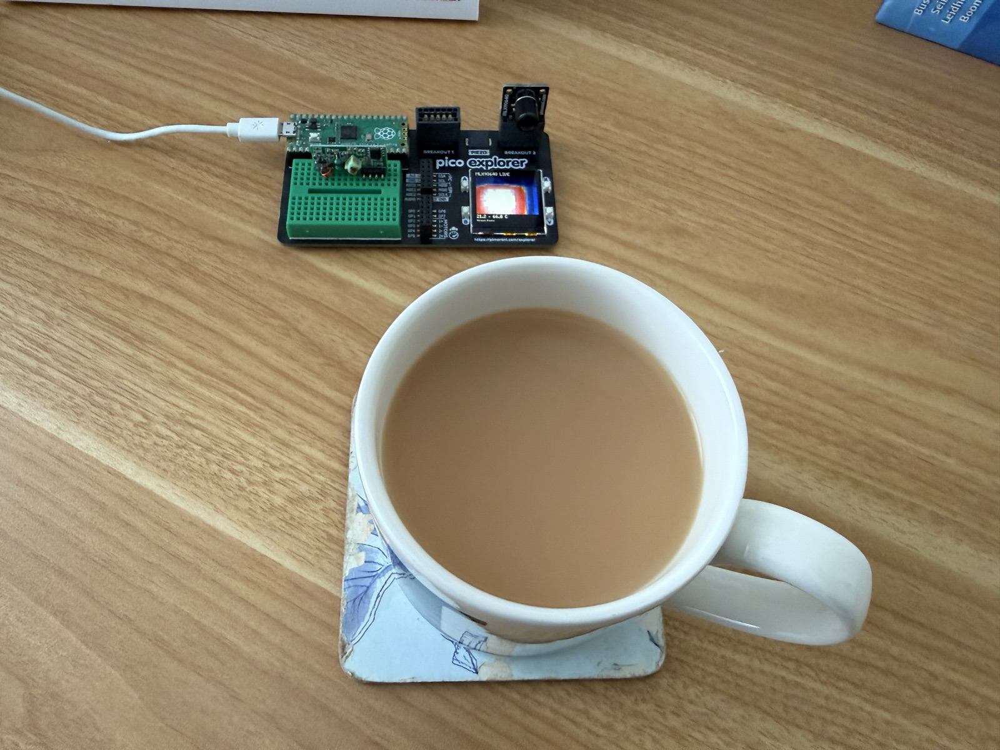

# Pico Explorer experiments

## RF receiver display experiment (current startup)

The current `main.py` runs an MX-RM-5V RF receiver experiment. It shows GP0
input activity on the Explorer display and flashes **REPEATED RF** when three
similar pulse frames arrive. Development uses a Faro Barcelona Pemba ceiling-fan
remote; its exact protocol and compatibility are still being established.

The current bench setup powers the receiver from **3V3**, with common GND and
DATA directly to **GP0**. Reception at this reduced supply is experimental.
Do not switch the receiver to 5 V with DATA connected directly to the Pico.
No piezo jumper is needed. **A** clears the displayed counts.

```sh
mpremote fs cp lib/rf_detector.py :lib/rf_detector.py
mpremote fs cp rf_sniffer.py :rf_sniffer.py
mpremote fs cp main.py :main.py
mpremote reset
```

This uses the Pimoroni firmware and existing `lib` directory described below.
An edge count includes receiver noise; a repeated burst is a heuristic, not
confirmation of a specific fan command. Raw candidate timings are logged over
USB for development. See the [RF wiring guide](docs/rf-receiver-wiring.md).

## Thermal camera experiment

A standalone thermal camera built with a Raspberry Pi Pico (RP2040), a
Pimoroni Pico Explorer Base, and a Melexis MLX90640 infrared sensor. It displays
a live 32×24 temperature map on the Explorer's screen, with minimum and maximum
temperatures in Celsius. After programming, processing and display run locally
on the Pico; the application does not record images or send them over a network.



*The camera in use viewing a cup of tea: the hot region appears white/red
against the cooler blue surroundings.*

Plug the MLX90640 into **Breakout 2**.
Both breakout sockets share I²C0: SDA **GP20**, SCL **GP21**. The camera
responds at **0x33**.

## Bill of materials

| Qty | Part | Notes |
| --- | --- | --- |
| 1 | Raspberry Pi Pico (RP2040) with soldered headers | Plugs into the Explorer Base |
| 1 | [Pimoroni Pico Explorer Base](https://shop.pimoroni.com/products/pico-explorer-base?variant=32369514315859) | Includes the display and breakout sockets |
| 1 | [MLX90640 Thermal Camera Breakout](https://shop.pimoroni.com/products/mlx90640-thermal-camera-breakout?variant=12549161746515) | Fits Breakout 2; linked variant is wide angle (110°) |
| 1 | Micro-USB data cable | Programming and USB power |

For the planned RF receiver experiment, see the
[wiring diagram and mini breadboard guide](docs/rf-receiver-wiring.md).

## Uses and experiment ideas

- **Check food and drinks before serving:** view approximate surface
  temperatures, spot hotter areas, and watch food or a cup of tea cool down.
  This is an experimental surface-temperature check: it cannot establish the
  internal temperature, whether food is fully cooked, or whether it is safe to
  eat or drink. Use a suitable food probe thermometer for safety-critical
  checks. See the [food thermometer guidance](https://www.foodstandards.gov.au/business/food-safety/thermometers)
  on the difference between infrared surface readings and probe measurements.
- **Explore privacy-preserving monitoring:** low-resolution heat maps could
  support presence, occupancy, or movement detection while capturing less
  visual detail than a conventional camera. A possible research application is
  occupancy or bedside-presence monitoring in a hospital context. These are
  future experiments; the current code only displays temperatures and does not
  detect people or generate alerts. Thermal data can still reveal sensitive
  activity, so low resolution alone does not guarantee anonymity. This
  prototype has not been validated for clinical monitoring or diagnosis.
- **Investigate heat around the home:** compare warm electronics, radiators,
  or cooling objects and observe how their surface-temperature patterns change.

Melexis describes people detection and occupancy sensing among the
[MLX90640's applications](https://www.melexis.com/en/product/MLX90640/far-infrared-thermal-sensor-array).
Readings depend on emissivity, reflections, distance, and how much of each
sensor pixel the target fills; the viewer currently assumes 0.95 emissivity.

## Run on the board

Use Pimoroni's **Pico** MicroPython firmware, tested with
[v1.29.0-2](https://github.com/pimoroni/pimoroni-pico/releases/tag/v1.29.0-2).
Hold BOOTSEL while connecting USB and copy the `pico-…-pimoroni-micropython.uf2`
file to the `RPI-RP2` drive. This replaces the installed firmware.

Install [mpremote](https://docs.micropython.org/en/latest/reference/mpremote.html),
then copy the application and driver (back up an existing `main.py` first):

```sh
mpremote fs cp :main.py original-main.py
mpremote fs mkdir :lib
mpremote fs cp lib/mlx90640.py :lib/mlx90640.py
mpremote fs cp experiments/thermal_camera.py :main.py
mpremote reset
```

Skip `mkdir` if `lib` already exists. With several connected boards, add
`connect /dev/cu.usbmodem…` before each command to select the Pico.
Copying `experiments/thermal_camera.py` to `main.py` restores the thermal viewer
as the power-on experiment; no computer is needed afterward. The RF setup above
switches back to the receiver display.

## Display and controls

The 32×24 thermal image is enlarged to 224×168 pixels. Colours run from blue
(cold) through yellow/red to white (hot). The displayed minimum and maximum
are in Celsius. The camera is set to 2 Hz; actual complete-frame display speed
is lower because temperature conversion runs in MicroPython.

- **A:** pause/resume the image.
- **B:** switch between automatic colour scaling and a fixed 15–40 °C scale.

The automatic scale spans at least 5 °C. Calibration assumes 0.95 emissivity;
readings depend on the surface and reflected heat. Camera errors appear on the
screen and are retried. A missing camera at startup requires checking the
connection and resetting the board.

## Driver and licences

`lib/mlx90640.py` derives from the MIT-licensed
[michael-sulyak driver](https://github.com/michael-sulyak/micropython-mlx90640/tree/4ff15dd1da2379039216c5d10c79f80cb22df603),
itself based on Adafruit's MLX90640 driver. Notices are retained in `licenses/`.
Local adaptations remove the unavailable `typing` dependency, fix partial
I²C reads and set iteration, acquire both sensor subpages for a complete frame,
and add timeouts. Factory-marked defective pixels are filled from neighbouring
pixels by the viewer.

Pimoroni documents the Explorer display and pin assignments
[here](https://github.com/pimoroni/pimoroni-pico/blob/main/micropython/modules/pico_explorer/README.md).
