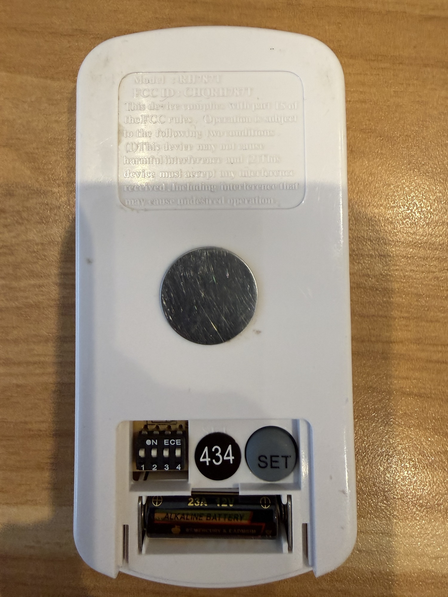

# Fan remote capture results — 18 November 2026

We recorded **27 labelled raw windows from 21 reported remote presses**: fan OFF
and speeds 1–6, three presses per button. All 27 windows transferred without
buffer overflow, containing 10,339 observed edges. The user confirmed the fan
responded during every button test. Capture and Mac logging were stopped at the
end; the Pico displayed **CAPTURE STOPPED**. Its startup files were not changed.

These are labelled observations, **not decoded command codes**. We have not
verified a stable binary/hex value, frame format, address, checksum, or replay
behaviour for any button. A complete recording means acquisition and transfer
finished without truncation, not that it contains a complete valid RF frame.

## Remote identification from the photograph



The user-supplied rear photograph shows:

- A faint moulded label appearing to read **Model RH787T** and
  **FCC ID CHQRH787T**.
- A circular **434** sticker. This suggests a 434 MHz variant, but is not a
  measurement of the carrier or proof of an exact 433.92 MHz frequency.
- Four numbered DIP switches, a **SET** button and a **23A 12V** battery.
  The battery voltage belongs to the handset, not to our RF receiver or Pico.

The existing project notes identify the target fan as a **Faro Barcelona Pemba**.
The photograph adds a handset identifier; it does not establish a unique fan
model or a universal button-code table. The front face is not shown, so no
additional button labels were inferred from this image. DIP switch positions
have not been transcribed or changed, and their encoding has not been decoded.
The JPEG is an orientation-corrected, resized copy with source metadata removed.

There is a frequency discrepancy to resolve. The manufacturer-submitted
[RH787T FCC test report](https://fccid.io/m/dd5e8cad887790b8a196cc73b390e7b3296ca31f1525fce29209f5fad63385a8.pdf)
identifies RH787T / CHQRH787T and specifies **303.946 MHz** for that tested unit.
That report does not establish the frequency of this handset with its **434**
sticker. Treat the actual carrier frequency as unverified until the fitted RF
resonator or a radio measurement establishes it. Do not select a decoder or
transmitter solely from the case model, sticker or another handset's codes.

## Hardware and acquisition settings

| Item | Recorded session setup |
| --- | --- |
| Host board | Raspberry Pi Pico on Pimoroni Pico Explorer Base |
| Receiver used for labelled dataset | **MX-RM-5V**, the older receiver from the Hackster experiment |
| Receiver supply | **5 V**, reported by the user; not measured in this session |
| DATA input | **GP0**, GPIO input with no pull resistor |
| DATA electrical interface | Direct connection reported; no level shifter reported and output voltage unverified |
| Acquisition | Hard IRQ on rising and falling edges, preallocated durations and sampled levels |
| Window / capacity | **250 ms / 8,192 edges** (about 40 KiB pulse/level storage) |
| Activity gate | At least 20 consecutive alternating intervals of 60–4,000 µs, spanning at least 6 ms |
| Storage | Mac JSON recordings plus serial transcript; no Pico flash recordings |
| Session ID | `20261118T081337289037Z-unlabelled-01-65941134` |

The direct 5 V-powered DATA connection is a record of what was reported on the
bench, **not a validated wiring recommendation**. The Pico input requires a safe
3.3 V signal. Resolve the interface with suitable buffering/level shifting before
repeating this setup; see the [buffered wiring proposal](rf-receiver-wiring.md#proposed-5-v-setup-with-a-buffer).

The command used for the guided run was equivalent to:

```sh
python scripts/log_rf.py --port /dev/cu.usbmodem1401 \
  --continuous --duration-ms 250 --receiver MX-RM-5V \
  --supply '5V (reported)'
```

`--supply` is log metadata, not a hardware voltage setting. The command does not
validate the electrical wiring. The program was executed in RAM via `mpremote`.
Display updates, garbage collection, gate analysis and USB transfers occurred
between windows, leaving unrecorded gaps. Capture IDs count saved windows, not
physical presses or decoded packets.

## Button-to-recording map

The user tested only one requested button at a time and confirmed the fan
responded. Labels use those reports and timestamps. The split of multiple
windows into individual presses is **inferred from time clusters**, not from a
protocol decoder or an independent physical button timestamp.

| Button | Press 1 IDs | Press 2 IDs | Press 3 IDs | Windows | Edges |
| --- | --- | --- | --- | --- | --- |
| OFF | 1 | 2, 3 | 4, 5 | 5 | 1,582 |
| Speed 1 | 6 | 7 | 8 | 3 | 901 |
| Speed 2 | 9, 10 | 11 | 12, 13 | 5 | 1,739 |
| Speed 3 | 14 | 15 | 16 | 3 | 779 |
| Speed 4 | 17 | 18 | 19 | 3 | 2,414 |
| Speed 5 | 20 | 21 | 22, 23 | 4 | 1,220 |
| Speed 6 | 24 | 25 | 26, 27 | 4 | 1,704 |
| **Total** | | | | **27** | **10,339** |

A [machine-readable summary and capture index](../captures/ceiling-fan/2026-11-18-summary.json)
records each window's time, label, inferred press number, edge count, completion
status, original local filename and SHA-256. Raw pulse arrays and the serial
transcript remain in the gitignored `captures/ceiling-fan/local/` directory.
They were also bundled locally as `fan-remote-captures-2026-11-18.zip`; the archive
and pulse payloads are not committed. A fresh clone has the summary/index but
needs the local dataset to reproduce signal analysis. Checksums refer to the
labelled JSON files after button metadata was applied.

## Signal observations and bring-up history

- The initial RXB6 2.0 trials did not establish remote reception. Some input
  traces were empty; others showed a roughly 50 Hz pattern rather than short
  command-like bursts. A GPIO pull-up/down check followed the internal pulls,
  consistent with a high-impedance input but not proof of a faulty receiver.
  Wiring continuity, signal voltage and actual receiver frequency were not
  independently established.
- After switching to the MX-RM-5V, qualifying windows appeared. Earlier
  three-second windows often exhausted the buffer; those exploratory recordings
  are excluded from this 27-window labelled dataset. Reducing the window to
  250 ms avoided overflow in the guided tests.
- Before the first guided button test, 52 rejected idle windows produced no saved
  captures. The activity gate is still a heuristic: this short baseline does
  not establish a false-positive rate or prove later captures came from the fan.
- Some labelled windows contain alternating intervals around **300 and 700 µs**.
  These are timing clues, not an established symbol encoding or bitstream.
- Substantial short-pulse interference remains, often around **60–70 µs**.
  Capture 18 has 1,846 edges, substantially more than the other speed 4 windows;
  its completed transfer does not imply better signal quality. Software IRQ
  latency may also affect observed timings; no logic-analyser comparison was done.

The fan responding confirms the original remote-to-fan path worked during the
tests. It does not independently prove the Pico captured the correct complete
command on every press. No transmitter was used and no captured command was
replayed. Light, reverse, SET/pairing, held-button behaviour and DIP-switch changes
were not tested. Logging remains stopped.

## Next analysis

1. Confirm the handset's actual RF frequency and receiver tuning, and establish
   a safe, measured DATA interface.
2. Inspect the labelled raw windows offline; separate candidate timing clusters
   and noise while retaining the original samples and polarity.
3. Establish repeatable frame boundaries and compare multiple presses per
   button. Identify shared address fields and changing command fields only if
   supported by complete repeated frames.
4. Verify any proposed decoder against fresh captures and idle/unrelated input
   before considering a transmitter or Home Assistant command/state integration.

For acquisition commands and data-field definitions, see the
[raw capture workflow](rf-raw-capture.md).
