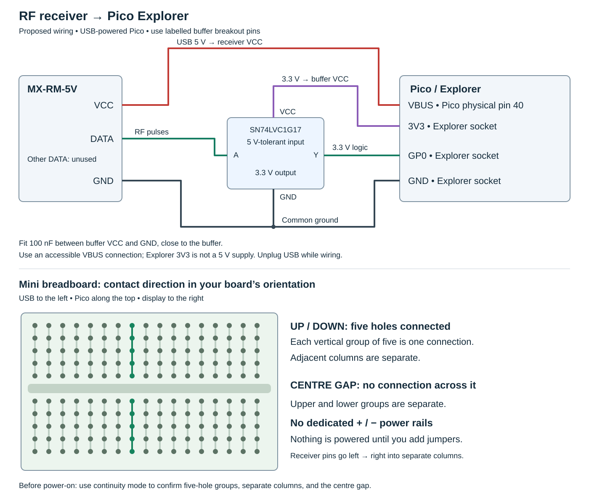

# RF receiver experiment

## Current bench setup: 3.3 V, display feedback

The receiver is currently powered from Explorer **3V3**, with **GND** shared
and **DATA → GP0** directly. The reduced supply avoids a 5 V DATA signal at
the Pico input, but receiver sensitivity and output logic levels at 3.3 V are
not guaranteed. This is a close-range development setup.

Copy `experiments/rf_display.py` to the Pico as `main.py` to start `rf_sniffer.py`.
The display shows input edges per second,
candidate frames, capture overflows, and repeated-burst counts. It flashes
**REPEATED RF** after three similar frames within 1.5 seconds and limits events
to one per second. Button A clears event/frame counts. No buzzer is used.
The detector assumes a frame gap of at least 4 ms, 20–220 edge intervals per
frame, and similar repeat timings; these initial settings may need tuning
from actual remote captures. Noise and other transmitters can also register.

The development target is a **Faro Barcelona Pemba** ceiling-fan remote. Faro
lists [remote 34303](https://faro.es/en/collection/accessory-34303/) at
433.92 MHz, but the exact handset fitted to this fan and its modulation/protocol
have not been confirmed. Start with normal speed-button presses around 0.5 m
from the receiver and compare the on-screen activity and USB timing logs.

The thermal camera app is retained as `experiments/thermal_camera.py` in the
repository and `thermal_camera.py` on the bench Pico. To restore thermal startup:

```sh
mpremote fs cp experiments/thermal_camera.py :main.py
mpremote reset
```

## Proposed 5 V setup with a buffer

Proposed connections for an MX-RM-5V receiver and the existing Pico Explorer
Base. This buffered 5 V circuit has not yet been assembled or tested. It is
an alternative to the current 3.3 V bench setup, not a drawing of its wiring.



## Connections

Disconnect USB before wiring. Looking at the receiver's labelled rear side
with its pins pointing down, the earlier photograph shows **GND, DATA, DATA,
VCC** from left to right. Use either DATA pin and leave the other unconnected.
Follow the actual board labels when connecting power.

| From | To |
| --- | --- |
| Receiver VCC | USB 5 V / Pico VBUS, physical pin 40 |
| Receiver GND | Explorer GND |
| Receiver DATA | SN74LVC1G17 buffer breakout input A |
| Buffer VCC | Explorer 3V3 |
| Buffer GND | Explorer GND |
| Buffer output Y | Explorer GP0 |
| 100 nF capacitor | Between buffer VCC and GND, close to the buffer |

Use a buffer breakout with accessible labelled connections; the diagram uses
signal names, not package pin numbers. The buffer is an additional part required
for this proposed circuit. Its input tolerates 5 V while its output follows
its 3.3 V supply. Do not connect receiver DATA directly to Pico GPIO. Receiver
output levels vary, so check the signal before substituting a resistor divider.

VBUS is available while the Pico is USB-powered. It is **not** the Explorer
3V3 socket. If physical pin 40 is inaccessible with the Pico fitted, arrange
an accessible USB 5 V connection rather than forcing a jumper onto a solder
joint. All circuit grounds must connect together. The Melexis camera can
remain attached: its GP20/GP21 I²C bus is separate from GP0.

## Which way are the breadboard contacts connected?

With **USB to the left, the Pico at the top, and the screen to the right**, as
in the project photos, the mini breadboard's connections run **up and down in
groups of five holes**. Each column has a separate upper group and lower group.

- The five holes in one vertical group connect together.
- Adjacent columns do not connect left to right.
- The horizontal centre gap separates the upper and lower groups.
- This mini breadboard has **no dedicated power rails** and no automatic
  connection to the Explorer's power sockets; add jumper wires as needed.

Place the receiver's four pins left to right in four separate columns, so they
do not short together. With power disconnected, confirm the layout using a
multimeter's continuity mode before wiring the circuit. The diagram shows
electrical connections rather than an exact component placement.

## References

- [Explorer Base](https://shop.pimoroni.com/products/pico-explorer-base?variant=32369514315859)
- [Explorer pin assignments](https://github.com/pimoroni/pimoroni-pico/blob/main/micropython/modules/pico_explorer/README.md)
- [Pico power and pinout](https://datasheets.raspberrypi.com/pico/pico-datasheet.pdf)
- [SN74LVC1G17 datasheet](https://www.ti.com/lit/ds/symlink/sn74lvc1g17.pdf)
- [Mini breadboard contact groups](https://www.microtivity.com/catalog/breadboards/breadboard-170)
- [Original Hackster doorbell project](https://www.hackster.io/robin-cole/pi-camera-doorbell-with-notifications-408d3d)
